# CalmOS

A quiet, debloated Android TV. CalmOS replaces the stock Google TV launcher with **Home**, a typographic launcher built from scratch, and adds a set of ADB scripts to switch off the ads, telemetry and clutter that ship with the TV.

Home can also link to an Apple TV over Apple's Companion protocol, the one the Remote in an iPhone's Control Centre uses. Your Apple TV's apps then appear alongside the Android ones, and opening one switches the TV to the Apple TV's input and launches the app there.

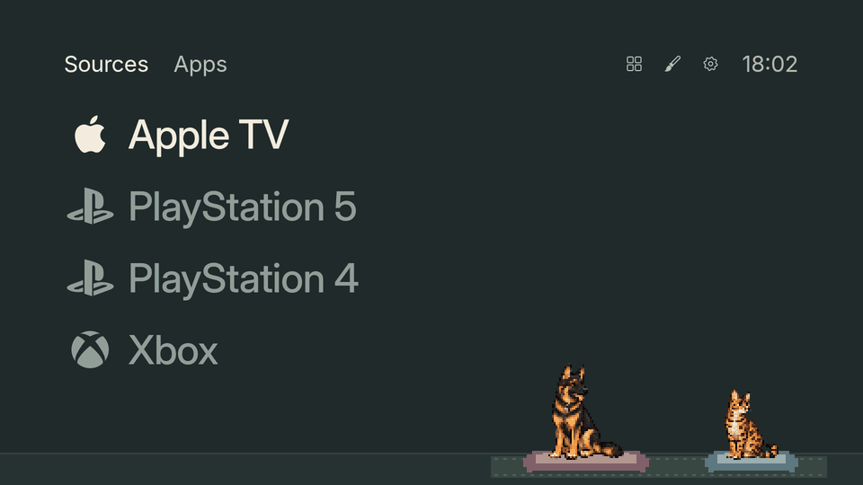

It was built for a Toshiba 65UA2B63DB (a Vestel Android TV 11 board, which Vestel codenames "cosmos"), but the launcher itself runs on any Android TV from Android 6 (API 23) up.

## Features

- **A calm home screen.** Two big typographic lists, Apps and Sources, a clock, and three corner controls. No rows of recommendations, no ads, no autoplay.
- **HDMI sources by name.** Every input is listed in port order and named from what you typed, its HDMI-CEC name, the TV's input settings, or the port name. Inputs in standby are faded. Each one can have its own name and icon.
- **Apple TV apps on Home.** Pair once with the code the Apple TV shows. Its apps appear in All apps and can be pinned. If you pinned an Android streaming app (Netflix, Disney+, Prime Video, YouTube, Apple TV) and later remove it, Home pins the Apple TV version instead.
- **Themes.** Light, Night, Pink, Blue Sky (a drifting pixel-art sky), Flowers (a swaying pixel meadow), Halloween (flickering pumpkins and a descending spider) and Idiots (a German shepherd and a Bengal cat chasing, riding and napping). Animations carry on across screens and stop while hidden.
- **Brand and custom icons.** PlayStation, Xbox, Nintendo, Apple and laptop icons are built in, and you can push your own PNG, JPG or WebP files. Single-colour icons are tinted to the theme.
- **Reversible debloating.** Every script change can be undone, and `checkpoint.sh` snapshots the TV's packages and settings before anything changes.
- **No dependencies.** Plain Java against the Android framework: no AndroidX, no Gradle, no third-party libraries. The Apple TV crypto (SRP-6a, X25519, Ed25519, ChaCha20-Poly1305, HKDF) is implemented in-tree so it works on older TVs.

## Screenshots

### Themes

| | |
|---|---|
| 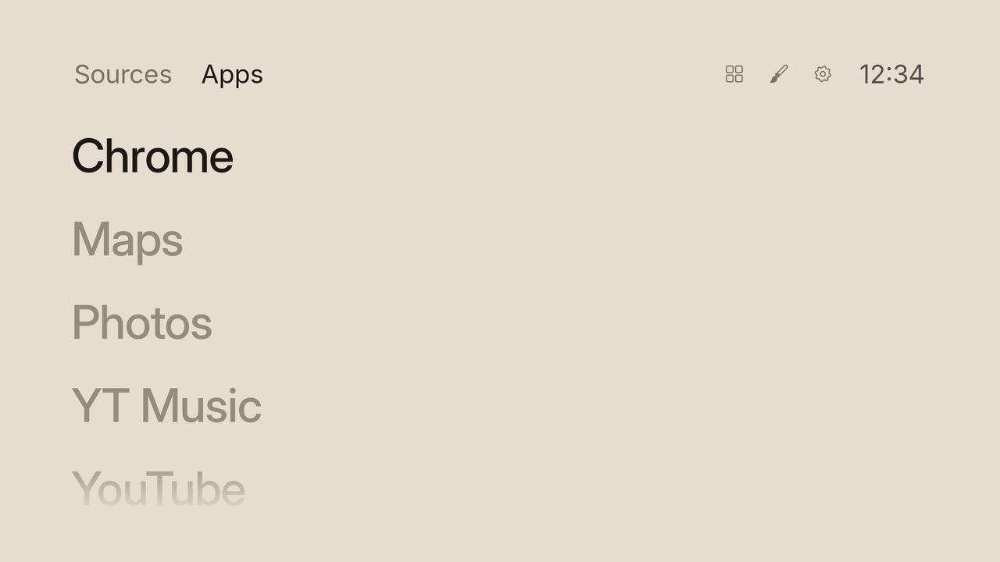 | 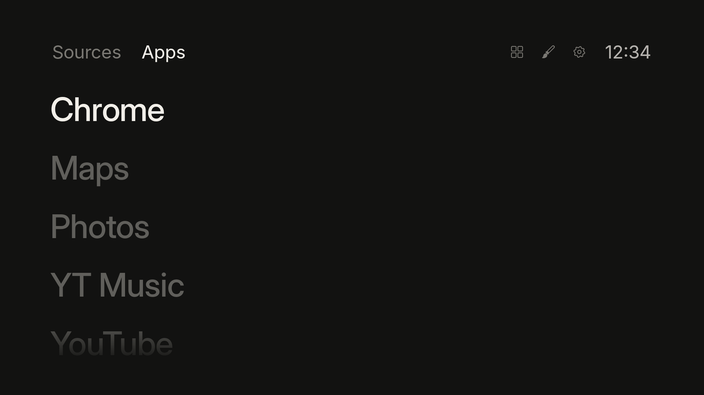 |
| **Light** | **Night** |
| 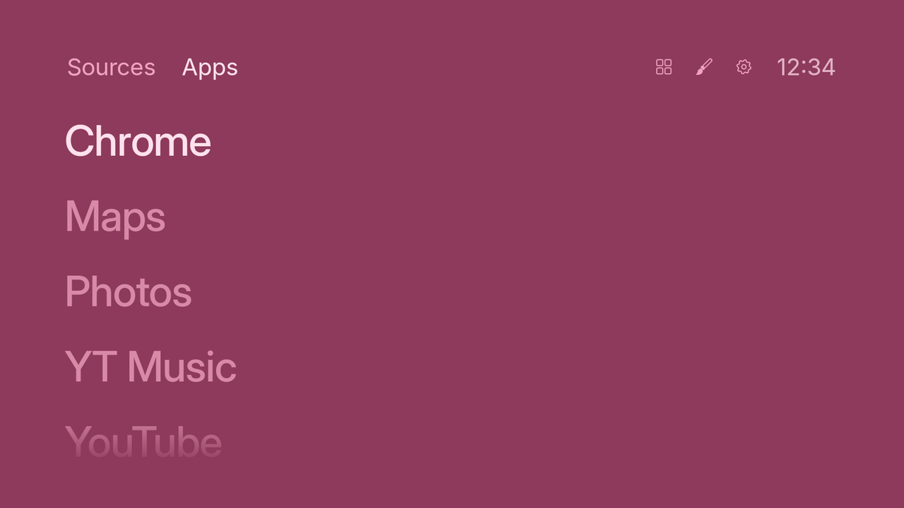 | 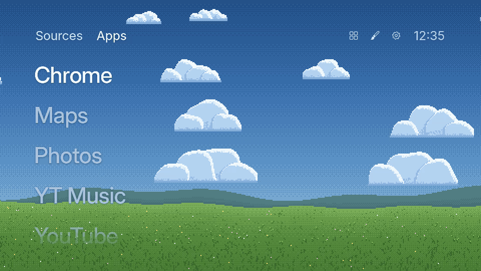 |
| **Pink** | **Blue Sky:** clouds drift across a pixel-art sky |
| 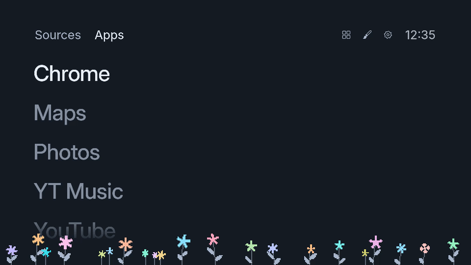 | 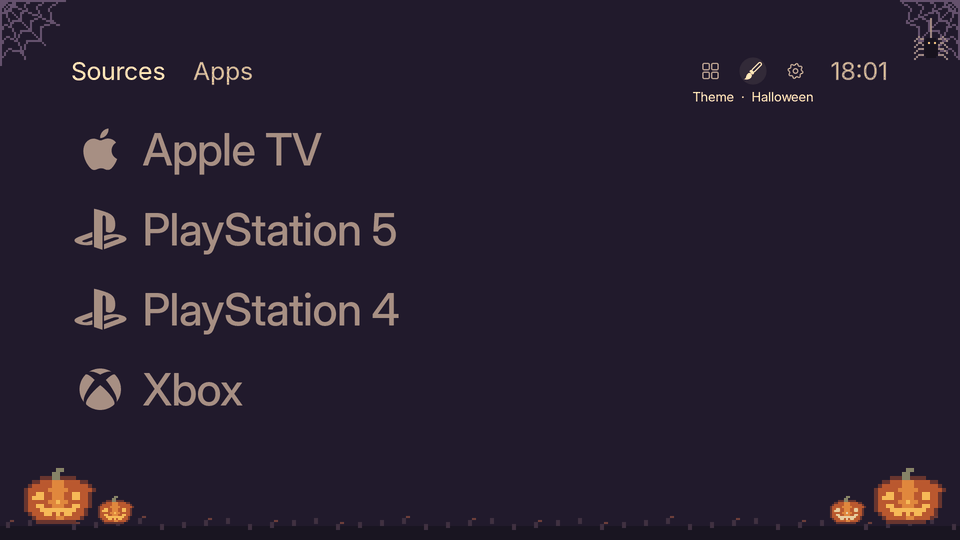 |
| **Flowers:** a pixel meadow sways in the wind | **Halloween:** pumpkins, webs and a spider |

There's also **Idiots**, where a German shepherd and a Bengal cat chase each other and nap:

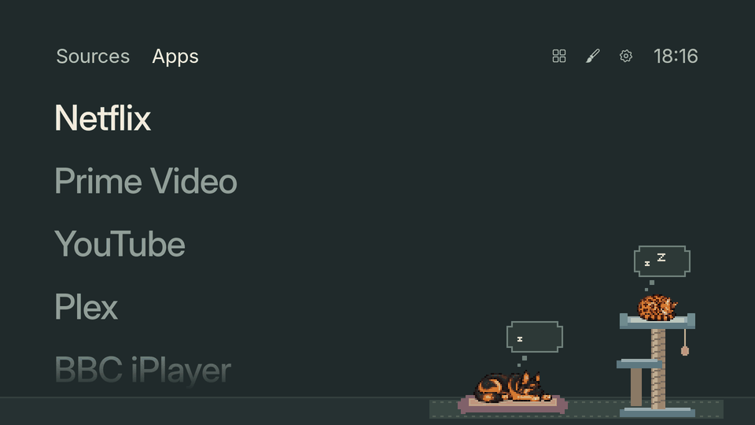

### Moving around

Opening All apps from the corner controls swings the list in, and Back swings it away again:

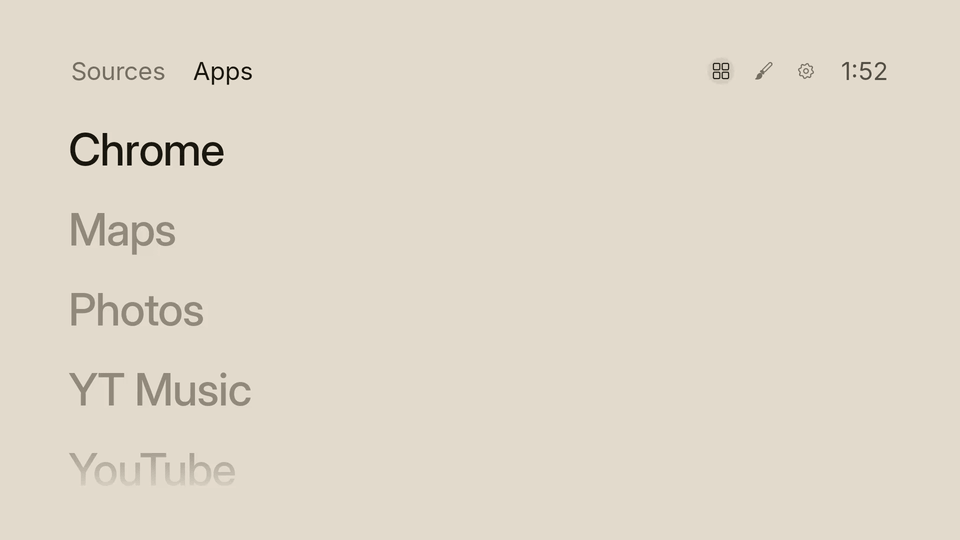

### Sources and All apps

| | |
|---|---|
| 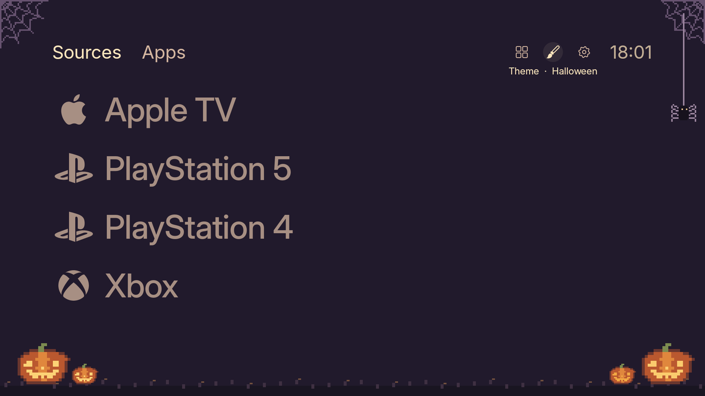 | 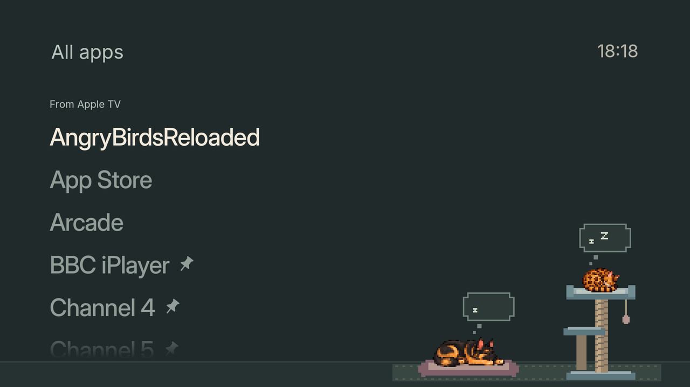 |
| **Sources:** every HDMI input by name, with brand icons | **All apps:** Android apps and apps from a linked Apple TV |

The Sources, All apps, Halloween and Idiots images were captured on the TV. Light, Night, Pink, Blue Sky, Flowers and the All apps transition were captured in an Android emulator, which has no HDMI inputs, so they show the Apps tab with the emulator's apps. The navigation, Halloween and Idiots animations are stitched from TV screenshots, so they're choppier than the real thing.

## Requirements

- An Android TV with **Developer options → USB debugging / Network debugging** turned on.
- [`adb`](https://developer.android.com/tools/adb) on your computer (`brew install --cask android-platform-tools` on macOS).
- To build from source: JDK 17 and the Android build tools (see [Build](#build)).
- Optional: an Apple TV on the same network, for Apple TV apps.

## Install

Build the APK first (see [Build](#build)), or download one from the Releases page and put it in `dist/` as `home-<version>.apk`.

```sh
adb connect <tv-ip>               # accept the debugging prompt on the TV
export CALMOS_TV=<tv-ip>:5555     # or pass the address as the first argument to each script
cd scripts && chmod +x *.sh
./make-default.sh                 # installs the newest dist/home-*.apk, checkpoints, makes it the Home button
./debloat.sh                      # optional: switches off the safe bloat list (see NOTES.md)
```

Undo with `./make-default.sh --undo` or `./debloat.sh --undo`. To roll everything back to a checkpoint, use `./restore.sh <checkpoint-dir>`.

| Script | What it does |
|---|---|
| `make-default.sh` | Installs Home, disables the stock launcher and the services that bring it back, and sets Home as the Home button. `--undo` restores the stock launcher. |
| `debloat.sh` | Disables telemetry, demo mode, ad channels and other bloat. `--extra` also disables Freeview Play catch-up, Chromecast and voice search. `--undo` re-enables everything. |
| `uninstall-bloat.sh` | A stronger option: per-user uninstall of the same apps, plus the Android streaming apps if you use them on an Apple TV instead. They stay in the firmware, so `--undo` or a factory reset brings them back. |
| `checkpoint.sh` | Saves `getprop`, package lists, settings and Play-installed APKs to `scripts/tv-checkpoint-<timestamp>/`. These folders are git-ignored because they contain device details and third-party APKs. |
| `restore.sh` | Returns packages to the state recorded in a checkpoint. |
| `verify-apk.sh` | Refuses an APK that is missing its bundled logos or theme sprites. Used by the build and by `make-default.sh`. |
| `test-themes.sh` | Runs the pet-animation tests on the desktop JVM. No TV needed. |

The package notes behind the debloat lists are in [NOTES.md](NOTES.md). They are specific to the Vestel firmware, so review them before running the scripts on another TV.

## Using Home

| Where | Button | Does |
|---|---|---|
| Anywhere on Home | ← → | Moves directly between Sources → Apps → corner controls. Home opens on Apps |
| Apps | OK | Open the app |
| | Hold OK (or Menu) | Reorder the list: ↑ ↓ moves the app, then OK or Back to finish |
| Sources | OK | Switch to that HDMI input |
| | Menu | Options menu: **Switch to**, **Rename and icon**, **Reset** (only if you've customised the input) and the Apple TV options below. Menu, Back or ← closes it |
| Corner controls | OK | **Theme** opens the theme menu. **All apps** opens every app, where you hold OK to pin or unpin. **Settings** opens the TV's settings |
| Anywhere | Home | Return to Home. Pressing it again on Home jumps to the top of Apps |

### Sources

The Sources tab lists HDMI 1–4 in port order. Each input is named, in order of preference, from:

1. The name you gave it.
2. Its HDMI-CEC device name.
3. The name set in the TV's Settings → Inputs.
4. The TV's own name for the port.

### Apple TV apps

1. On Sources, select the input your Apple TV is plugged into and press Menu → **Link Apple TV apps**.
2. Pick your Apple TV from the list Home finds on the network, then type the code the Apple TV shows.
3. Its apps now appear in All apps, where you can pin them like any other app.

| 1. Search | 2. Type the code | 3. Link |
|---|---|---|
|  | 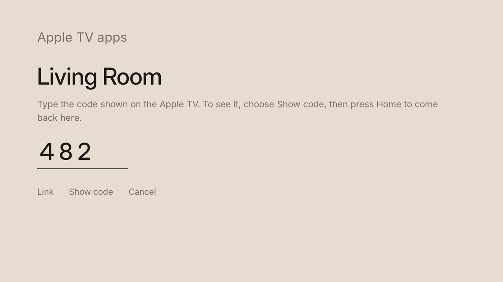 | 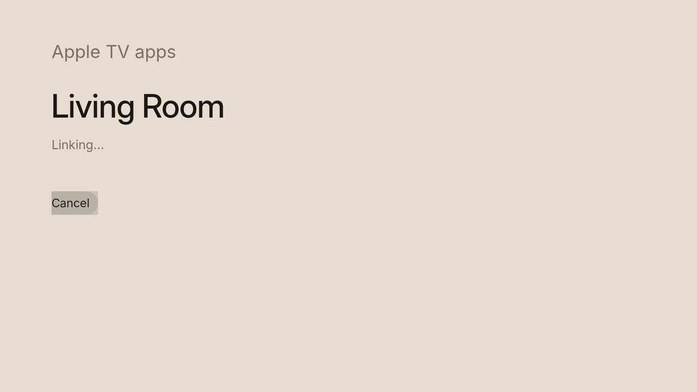 |

These pairing screens were captured in an emulator against a stand-in Apple TV. That is why the Apple TV is called "Living Room".

Opening an Apple TV app switches the TV to that input and launches the app on the Apple TV. The same menu offers **Refresh Apple TV apps** and **Unlink**, or moves the Apple TV to a different input. Home appears as "Home" in the Apple TV's list of remotes. For debugging, run `adb logcat -s CalmOS-ATV`.

> **Note:** if your Apple TV has learned your TV remote it can lead to duplicated input across the TV launcher and the ATV. It's advised to unlink the learned TV remote if you're not using the ATV remote as default.

### Themes

**Halloween** adds pixel pumpkins with gently flickering candles, corner webs and a slowly descending spider. **Idiots** pairs Moose the German shepherd with Tofu the Bengal. They alternate between chasing one another and a slower search, with Tofu secretly riding on Moose's back. Tofu jumps into the top of his cat tree and curls up, and Moose returns to his bed. Each two-minute cycle includes 30 seconds of activity and 90 seconds of rest.

### Your own icons

Copy PNG, JPG or WebP files to the TV:

```sh
rsvg-convert -h 512 logo.svg -o playstation.png      # brew install librsvg
adb push playstation.png /sdcard/Android/data/works.uncommon.home/files/icons/
```

These icons appear first in the editor's icon picker. A file is also used automatically for any source whose name contains the file name, so `playstation.png` matches "PlayStation 5". Single-colour images with transparency are tinted to the theme. Full-colour images keep their colours and fade along with the text.

## Build

```sh
cd launcher && ./build.sh
```

The build uses `aapt`, `javac` (JDK 17), `d8` or `dx`, `zipalign`, `apksigner` and `unzip`, and compiles against `platforms/android-23/android.jar`.

- **macOS with the Android SDK:** run `ANDROID_SDK=~/Library/Android/sdk BUILD_TOOLS=~/Library/Android/sdk/build-tools/<version> ./build.sh`. You need the android-23 platform installed (`sdkmanager "platforms;android-23"`).
- **Ubuntu:** run `apt install aapt dalvik-exchange zipalign apksigner android-sdk-platform-23 openjdk-17-jdk-headless`. This works with no extra setup.

The signed APK is saved to `launcher/home.apk` and `dist/home-<version>.apk`. Increment the manifest's `versionCode` for each release.

On the first build, `build.sh` creates a signing key at `launcher/home.keystore`. Set `KEYSTORE_PASS` to choose its password. Keep the keystore safe and out of version control (it is git-ignored): a build signed with any other key won't install over an existing copy of Home.

Run `bash scripts/test-themes.sh` from the project root to check pursuit order, passenger positioning, continuous jumps, tree landings and rest at four screen widths.

## Project structure

```
CalmOS/
├── launcher/                    Home, the launcher app
│   ├── AndroidManifest.xml
│   ├── build.sh                 aapt + javac + d8 + zipalign + apksigner, no Gradle
│   ├── src/works/uncommon/home/
│   │   ├── HomeActivity.java    Apps and Sources tabs, corner controls, menus
│   │   ├── AppsActivity.java    All apps, pin and unpin
│   │   ├── EditSourceActivity   Rename an input and pick its icon
│   │   ├── AtvPairActivity      Find and pair an Apple TV
│   │   ├── Apps, Sources        Installed apps and HDMI inputs
│   │   ├── TypeList, IconView   The typographic list and line icons
│   │   ├── Look, ThemeDecor     Palettes, type, sizing and shared animation timeline
│   │   ├── SkyView, MeadowView, HalloweenView, IdiotsView, PetChase, PetSprites
│   │   │                        Pixel-art themes
│   │   ├── AppleTv, Companion   Apple TV discovery, pairing, app list and launch
│   │   └── Srp, Nacl, ChaChaPoly, Opack, Tlv8
│   │                            Crypto and wire formats for the Companion protocol
│   ├── tests/                   PetChaseTest (plain JVM)
│   ├── res/                     Icon, banner, styles, brand logo vectors
│   ├── assets/                  Inter fonts and theme sprite sheets
│   └── artwork/                 Source SVGs and sprite generation prompts
├── docs/screenshots/            Images used in this README
├── scripts/                     ADB scripts: install, debloat, checkpoint, restore
├── dist/                        Built APKs (git-ignored; publish them as releases)
└── NOTES.md                     Package notes and debloat plan for the Vestel TV
```

## About the TV

- This build was made for the **Toshiba 65UA2B63DB** (a Vestel "Cosmos" board running Android TV 11, build RTOC.251019.001). Point your agent at the repo to build for your specific hardware.
- The stock home app is `com.google.android.tvlauncher`. Live TV is handled by `com.mediatek.wwtv.tvcenter`.
- Play Protect blocks sideloaded apps that target old SDKs, so Home targets SDK 35 and declares `QUERY_ALL_PACKAGES`.

## Credits

- The Companion protocol, OPACK and pairing implementation follow [pyatv](https://github.com/postlund/pyatv).
- X25519 and Ed25519 are a Java port of [TweetNaCl](https://tweetnacl.cr.yp.to/).
- Brand logos come from [Simple Icons](https://simpleicons.org/) under CC0 (see [launcher/artwork/source-icons](launcher/artwork/source-icons/README.md)). Brand names and trademarks remain their owners' property.
- Type is set in [Inter](https://rsms.me/inter/) by Rasmus Andersson, under the SIL Open Font License 1.1.
- Theme sprites are documented in [launcher/artwork/themes](launcher/artwork/themes/README.md).

CalmOS is not affiliated with Apple, Google, Toshiba or Vestel.

## License

[MIT](LICENSE)
